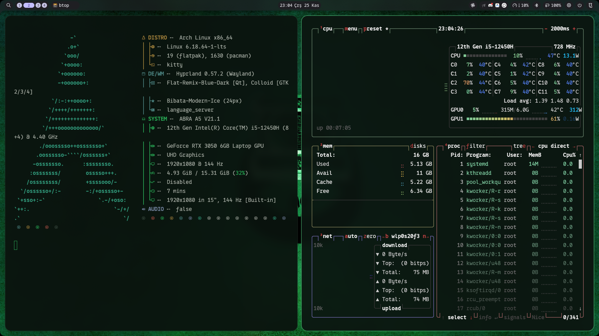

# Dotfiles (Hyprland & Noctalia)

Personal configuration files for **Hyprland** (Lua config) and **Noctalia**.

## Screenshots




## Structure

- `hypr/` — Hyprland configuration (`~/.config/hypr`, using `hyprland.lua`)
- `noctalia/` — Noctalia configuration (`~/.config/noctalia`)

## Installation

### 1. Dependencies (Arch Linux)

Make sure you have Hyprland, Noctalia Shell, and the core tools used in `hyprland.lua` installed:

```bash
sudo pacman -S hyprland kitty grim slurp wl-clipboard brightnessctl playerctl hyprlock
```

> Also install **Noctalia Shell** (`quickshell` / `noctalia`) and your preferred launcher/file manager/browser if you use them.

### 2. Clone the Repository

```bash
git clone https://github.com/alitura1/dotfiles.git ~/dotfiles
```

### 3. Back Up Existing Configs (Recommended)

```bash
mv ~/.config/hypr ~/.config/hypr.bak 2>/dev/null || true
mv ~/.config/noctalia ~/.config/noctalia.bak 2>/dev/null || true
```

### 4. Link or Copy Configs

**Option A — Symlink (recommended if you want `git pull` to update directly):**

```bash
ln -s ~/dotfiles/hypr ~/.config/hypr
ln -s ~/dotfiles/noctalia ~/.config/noctalia
```

**Option B — Copy:**

```bash
cp -r ~/dotfiles/hypr ~/.config/hypr
cp -r ~/dotfiles/noctalia ~/.config/noctalia
```

### 5. Reload Hyprland

```bash
hyprctl reload
```

## Keybinds Highlights

| Shortcut | Action |
| --- | --- |
| `Super + Return` | Open terminal (`kitty`) |
| `Super + Space` / `Super + Shift + F` | Toggle fullscreen |
| `Super + V` | Toggle floating |
| `Super + Q` | Close active window |
| `Super + Shift + Q` | Force stop active window (`kill -9`) |
| `Super + Shift + S` | Noctalia region screenshot |
| `Alt + Space` | Toggle Noctalia panel |
| `Super + Control + L` | Lock screen (`hyprlock`) |
| `Super + 1..0` | Switch workspace |
| `Super + Shift + 1..0` | Move window to workspace |
