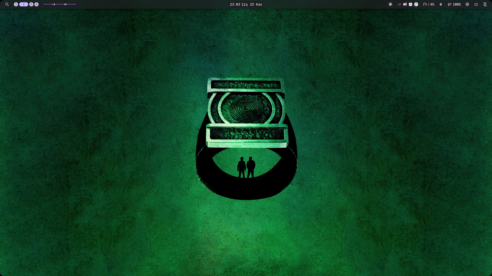

# Dotfiles (Hyprland & Noctalia)

Personal configuration files for **Hyprland** and **Noctalia**.

## Screenshots




## Structure

- `hypr/` — Hyprland configuration (`~/.config/hypr`)
- `noctalia/` — Noctalia configuration (`~/.config/noctalia`)

## Usage

Clone the repository and copy or symlink the folders into `~/.config/`:

```bash
git clone https://github.com/alitura1/dotfiles.git ~/dotfiles
```
